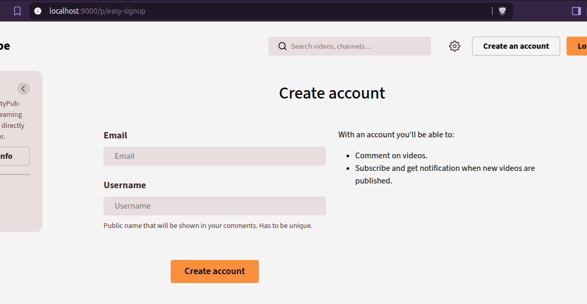

# Easy signup - Peertube plugin

Simplify user registration by reducing it to two form fields. In order to get a smooth user experience the Peertube instance shouldn't require approval upon signup nor require email verification.

The user password is randomly generated, sent to Peertube API and then forgotten. So the user has to manually reset their password next time they want to login.